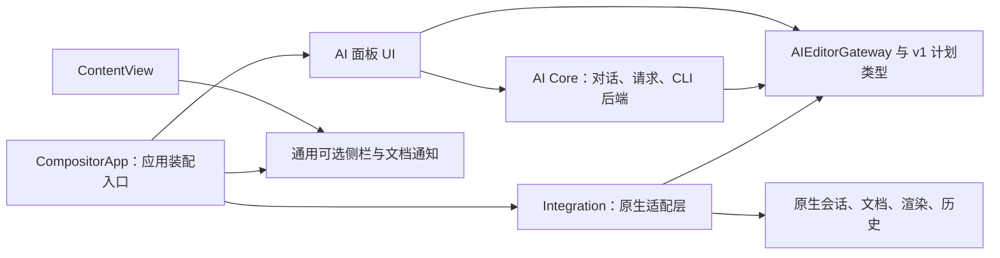

# AI 与原生编辑器解耦（0.5.0）

这次实现的目标是降低 AI 对原生编辑器内部结构的依赖，同时保持 AI 与手动操作共用同一份文档和原生撤销记录。采用源码层与协议层的边界，而不是另写渲染器或编辑器。

## 依赖关系

图中箭头表示源码依赖。原生 EditorSession 不持有 AI 对话或面板状态；AI Core 和面板也不认识 EditorSession、CanvasDocument、ProjectSnapshot、ImageExporter 或原生历史。

运行时仍由 AI 提交类型化计划，经过接口交给原生适配层。适配层先验证完整计划，再使用原生编辑方法执行；一次 AI 编辑仍对应一个原生撤销步骤。

## 实际改动

| 边界 | 重构前 | 0.5.0 |
| --- | --- | --- |
| 对话与面板状态 | 存放在 EditorSession | 应用接入层按标签页管理，原生会话不持有 AI |
| 助手与预览 | 助手直接读取文档、调用 ImageExporter | 通过接口获得 JSON 上下文及可选预览数据操作 |
| 待确认计划 | 应用时传入 EditorSession | 保留原请求的接口与不透明句柄，不能从面板另指定目标 |
| AI 面板 | 读取原生文档与编辑状态 | 只读取接口提供的可用状态和图层名称 |
| 原生 UI | 直接构造 AI 面板、清空 AI 对话 | 只提供通用可选扩展钩子，默认是空实现 |
| 标签页关闭 | AI 状态随原生会话一起存在 | 清理对话与请求、释放句柄、断开适配器；适配器不强持有会话 |
| 边界验证 | 单一应用编译容易隐藏跨模块依赖 | CI 单独编译真实 AI Core/UI，不加入任何原生编辑器源码 |

## 文件与责任

- `Compositor/AI/Core/`：v1 计划与命令类型、AIEditorGateway 接口、对话和请求生命周期、CLI 后端与受控进程。仅使用 Foundation / Observation 等平台能力及共享的显示本地化辅助函数。
- `Compositor/AI/UI/`：AI 面板、输入、设置、待确认列表；只依赖核心协议。选择 CLI 文件使用系统 AppKit 文件面板。
- `Compositor/AI/Integration/`：原生快照与历史版本、上下文提取、ImageExporter 预览、计划验证与原生执行、每个标签页的状态和装配。
- `Compositor/UI/EditorExtensions.swift`：原生 UI 的通用空钩子，不包含 AI 类型。
- `CompositorApp.swift`：唯一直接引用 AI 类型的原生装配入口，安装可选扩展与“AI 助手”菜单。菜单顺序与无专用快捷键的设置保留。

`AIEditorCommands` 的原生整批验证与执行方法保持原实现，只搬入适配目录。`.comp`、渲染、手动工具、参数范围、快捷键和文档历史没有重写，也没有私有 AI 文件字段。AI 面板默认关闭，未安装扩展时通用钩子不显示内容。

## 接口与请求生命周期

接口输出 JSON 上下文、不透明的 AIRequestToken、可选的异步 PNG 数据操作。原生文档与历史快照只保存在适配层；Core 不携带这些结构。

句柄由产生它的适配器校验，其他适配器、已释放句柄与已断开的编辑器均拒绝执行。原生快照与历史版本检查保留，因此手动改动后的旧结果仍会被拒绝。

成功、无编辑的回复、失败、取消、丢弃计划及切换后端会释放不再需要的快照。待确认计划持有自己的接口与句柄，确认后释放。关闭标签页会取消该标签页的 AI 请求并断开适配器；其他标签页的对话不受影响。

未开启图片时，Core 不会调用预览操作。开启后仍由原生 ImageExporter 渲染，并将长边缩到最多 1,400 像素；25 百万像素限制保持一致。图像不是屏幕截图，CLI 收到的文档坐标仍来自原始画布尺寸。

## 每次升级如何使用这个边界

1. 按 UPSTREAM.md 在独立升级分支合并指定上游版本，保留原生能力。
2. 原生 API 改动在 Integration 中适配；不要把原生类型泄露给 Core/UI，也不要把 AI 状态重新塞回 EditorSession。
3. 保留 ContentView 的通用侧栏/文档通知位置和 CompositorApp 的装配入口。新增中文文字仍按显示用途翻译。
4. 运行 `bash scripts/check-ai-boundaries.sh` 与 `scripts/test.sh`，再对原生编辑和 AI 编辑进行人工验收、构建和发布。

边界检查包含两部分：原生 Swift 文件不得引用 AI 类型或旧 AI 状态（CompositorApp 除外）；真实 Core/UI 与 Foundation 本地化辅助源码以独立模块进行类型检查，不允许靠原生模型/渲染器源码完成编译。检查已经加入本地测试脚本及 GitHub CI。它约束源码依赖，不是运行时安全沙箱。

## 验证和限制

新增回归覆盖：独立假编辑器经协议完成规划与提交、图片显式启用、待确认计划的接口绑定与释放、过期计划、切换接口、预览中取消、错误上下文、无编辑回复、外来/释放/断开句柄、会话释放、原生预览尺寸、各标签页独立状态及文档切换清理。既有后端限制与原生命令/撤销测试继续保留。

本应用仍以一个可执行程序发布；Core/UI 的独立编译是可验证的源码边界，尚未拆成可单独下载的二进制动态插件。共享显示本地化是明确保留的依赖。未来若需要独立 SDK 或其他宿主，可在现有接口上建立新的构建目标与适配器，但当前不宣称支持任意软件热插拔。

解耦减少上游合并时受影响的范围，并不能证明任意原版更新自动兼容或零 bug。当前采用的上游基线仍为 Compositor 1.4.8；1.4.9 的完整合并不属于本次重构。测试与实际界面检查的结果见本版 Release 验证记录。
